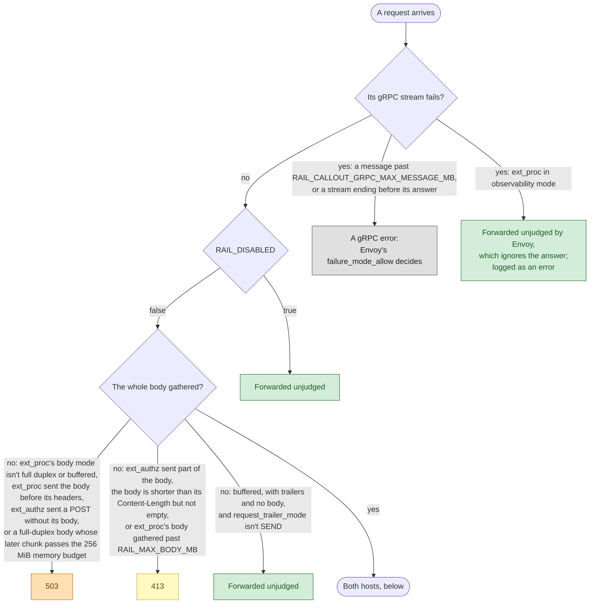
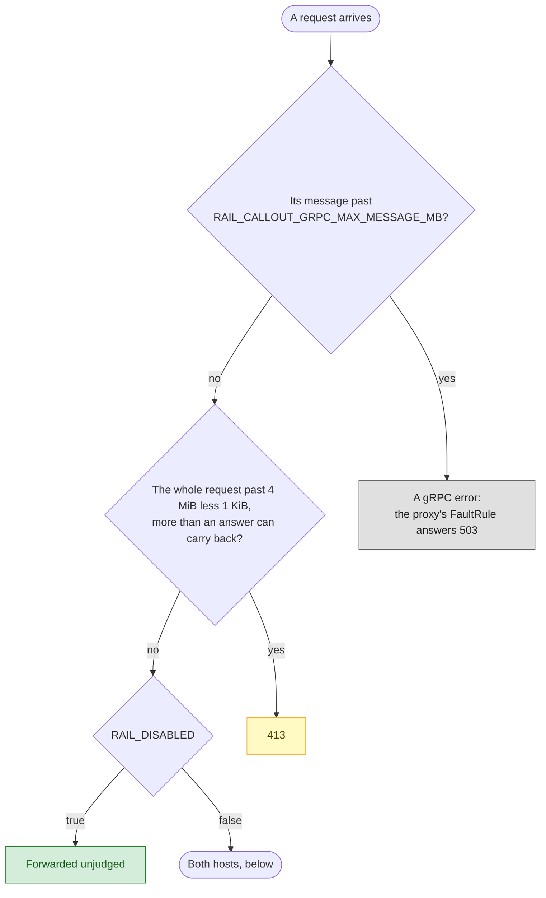
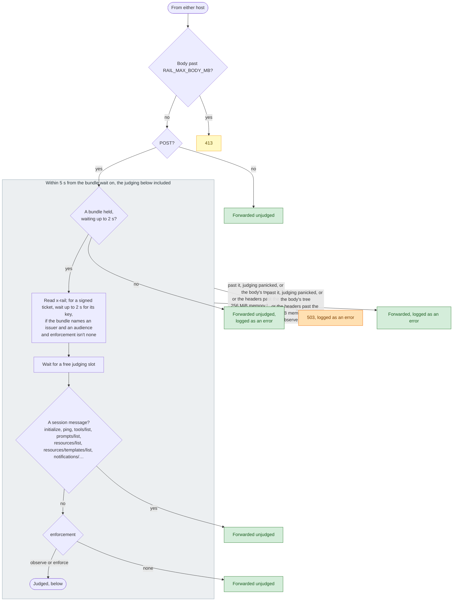
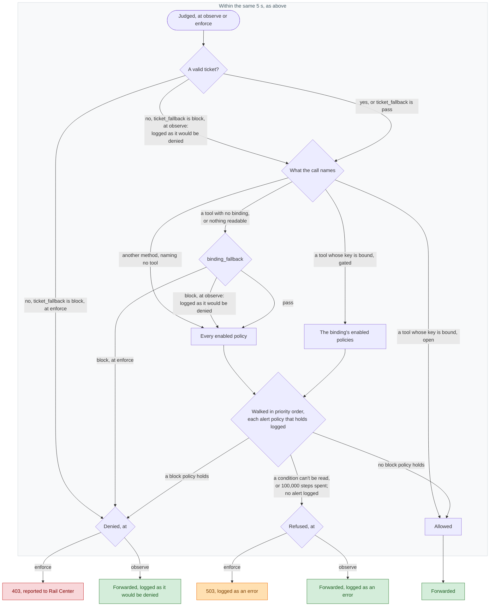

# The gateway's decisions

What the gateway, `rail-apigee` or `rail-envoy` as `rail gateway`, does with each request, in the order it decides. Each
host first checks what only it can, then hands the call to the steps both share. See the [main README](README.md) for
the system around it, and [`CONFIGURATION.md`](CONFIGURATION.md) for the settings named.

Outcomes are coloured by what happens to the call: green forwarded, red denied (403), orange the rules can't be applied
(503), yellow too large (413), grey a gRPC error the host acts on.

## rail-envoy

## rail-apigee

## Both hosts: whether a call is judged

## Both hosts: how a call is judged

A call the gateway forwards goes on without the agent's `x-rail`, `x-rail-*` and `_` headers. A refusal the gateway
answers names no policy: 403 `{"error": "denied by policy"}`, 503 `{"error": "policy ruleset cannot be applied"}`, 413
`{"error": "request body too large"}`.
