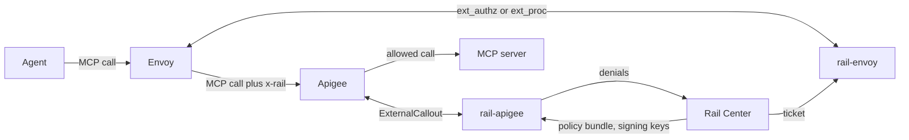

# RailGuard

DatRail lets an organisation decide what its AI agents may do with the MCP servers they call. Rail Center, a separate
service, keeps the rules, and issues each agent a ticket saying what it knows about that agent. RailGuard enforces those
rules on the network: a gateway in front of MCP servers judges each call against the rules, and a proxy beside the
agents attaches their tickets to the calls they make.

It's one Rust workspace for both, and for the rules language they share. The language is also built as a Python package,
so Rail Center can check a rule with the same code the gateway enforces it with.

## Architecture



- **Agent to proxy.** The agent's own calls, which rail-envoy doesn't trust: it removes any `x-rail` header the agent
  set, so an agent can't present a ticket of its own making, and adds this host's ticket for a protected MCP server.
- **Proxy to gateway.** The call with its ticket in `x-rail`. rail-apigee checks a signed ticket against Rail Center's
  keys; an unsigned one is read as it is, so it's only as good as the path from the proxy.
- **Gateway to MCP server.** A call the rules deny gets rail-apigee's refusal instead; any other is forwarded, with the
  `x-rail` headers removed. Where the MCP servers are behind Envoy, or GCP's Application Load Balancer, rail-envoy is
  the gateway instead (`rail gateway`), judging each call the same way.
- **Rail Center to both.** Each host fetches what it needs and keeps it through an outage: the proxy its ticket while
  it's valid, the gateway its bundle, and the keys tickets are signed with for 900 s. The gateway reports each denial
  back, so people can see what was stopped and why.

Each host's README has its own flow: [rail-apigee](crates/rail-apigee/README.md#architecture) and
[rail-envoy](crates/rail-envoy/README.md#architecture).

## What's here

| Path                                                                   | What it is                                                                                                       |
| ---------------------------------------------------------------------- | ---------------------------------------------------------------------------------------------------------------- |
| [`crates/rail-policy`](crates/rail-policy/README.md)                   | The rules language: reads policy bundles and tickets, and judges a call.                                         |
| [`crates/rail-policy-py`](crates/rail-policy-py/README.md)             | The language as a Python package, `datrail-policy`, for Rail Center and RailDash.                                |
| [`crates/rail-runtime`](crates/rail-runtime/README.md)                 | What a running host does around the language: its settings, Rail Center, and the gateway's judging of each call. |
| [`crates/rail-grpc-host`](crates/rail-grpc-host/README.md)             | The process parts both gRPC hosts share: the command line, health checks and shutdown.                           |
| [`crates/rail-apigee`](crates/rail-apigee/README.md)                   | The gateway, as an Apigee callout.                                                                               |
| [`crates/apigee-callout-proto`](crates/apigee-callout-proto/README.md) | Apigee's callout interface, as Rust code.                                                                        |
| [`crates/rail-envoy`](crates/rail-envoy/README.md)                     | The proxy, and the gateway, as an Envoy extension.                                                               |
| [`crates/rail-test-support`](crates/rail-test-support/README.md)       | What the tests share.                                                                                            |
| [`e2e`](e2e/README.md)                                                 | End-to-end tests: each host's image in front of the software it plugs into.                                      |
| [`CONFIGURATION.md`](CONFIGURATION.md)                                 | Every setting both hosts read.                                                                                   |
| `vectors`                                                              | The conformance cases that define how the language and the gateway behave.                                       |

## Development

```sh
make lint      # rustfmt and clippy
make test      # the Rust tests
make test-py   # builds the datrail-policy wheel and runs its tests; needs uv
make check     # all three, plus the Python lint
make fmt-md    # formats the markdown with Prettier; make lint-md checks it; needs npx
```

The end-to-end stacks need Docker and run separately; see [`e2e`](e2e/README.md).

## Related

- [datrail-project](https://github.com/datrail/datrail-project#readme) is the entry point to DatRail: how its components
  fit together.
- [RailDash](https://github.com/datrail/raildash) presents captures locally, and is to try a rule on a sample call
  through `datrail-policy`.

## Security

To report a vulnerability, see [SECURITY.md](SECURITY.md): privately, through the repository's Security tab, not as an
issue.

## License

Apache-2.0. See [LICENSE](LICENSE).
