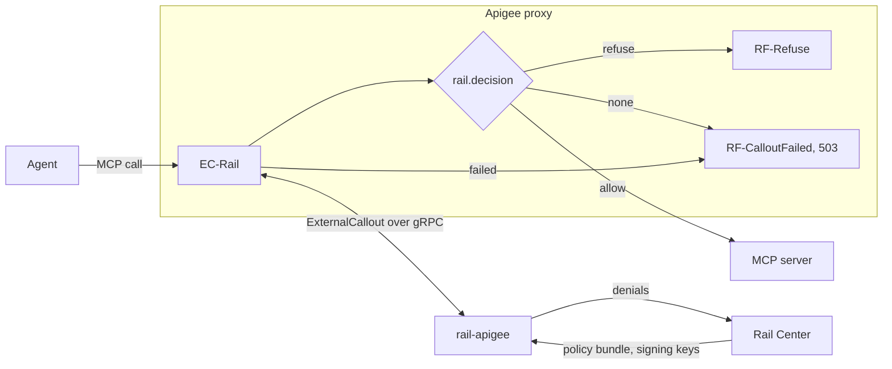

# rail-apigee

The gateway, for MCP servers behind Apigee. Apigee hands it each request on its way to an MCP server; rail-apigee judges
the call against Rail Center's rules, using the caller's ticket, and tells Apigee to forward it or to refuse it. It
reports each denial to Rail Center, so people can see what was stopped and why. See the [main README](../../README.md)
for the system around it.

## Architecture

Apigee's ExternalCallout service, over TCP on `RAIL_CALLOUT_PORT`. It judges each `POST` against the policy bundle held,
and answers with what Apigee should change: the received context, with every `x-rail` and `x-rail-*` header removed, and
every name holding `_` (some upstreams read it as `-`), and the flow variable `rail.decision` set to `allow` or
`refuse`, plus `rail.status` and `rail.body` for a refusal. The proxy (below) acts on them.

- **Changes only its own.** Nothing else in the context changes: Apigee applies only what the answer's maps hold.
- **Session messages aren't judged.** A request other than a `POST` is allowed, and so is a session message
  (`initialize`, `tools/list`, a notification), since judging it would let a rule bound to one tool close the session.
  At enforcement `none`, every call is allowed unjudged.
- **A refusal names no policy.** 403 `{"error": "denied by policy"}` for a call the rules deny, 503
  `{"error": "policy ruleset cannot be applied"}` for one they can't be applied to, so a caller can't map the rules one
  attempt at a time.
- **A body past `RAIL_MAX_BODY_MB` is refused unjudged,** 413 `{"error": "request body too large"}`, with a warning
  logged; it isn't reported.
- **Answers within 5 s** of the request's arrival. A call not judged by then is logged as an error: refused at
  `enforce`, 503, as one the rules can't be applied to; forwarded at `observe` and `none`.
- **Fails closed when it's down,** with the proxy below: a callout that's down, times out or answers without a decision
  forwards nothing.

## At startup

It runs as `rail-apigee gateway` (`rail gateway` in its image), its one role. The role has no default: none, or another,
is a usage error, exit 2. It logs `starting`, with its version, commit and role, then reads every setting, and prints
every refusal at once and exits 2, so they're all fixed in one round; a port it can't listen on exits 2 too. Then it
logs a `setting` line for each one it uses, with its value and whether it came from the environment or the default, a
secret only as `set` or `unset`. A value that weakens something is logged as a warning saying what
(`RAIL_DISABLED=true`, an `http://` Rail Center), and so is a `RAIL_…` variable nothing reads, as a likely typo. It
starts fetching the bundle and the signing keys, then logs `serving the ExternalCallout service`. Every line, `starting`
included, is in the format `RAIL_LOG_FORMAT` names: JSON by default, Cloud Logging's on Cloud Run, or text.

## When Rail Center is down

- **The bundle:** the last usable one is kept for ever, and fetched again with a backoff. Until the first one is held,
  readiness is NOT_SERVING; a call that arrives anyway waits up to 2 s for it, then is forwarded unjudged, logged as an
  error.
- **The signing keys:** held for at most 900 s after the last good fetch. Past that, a signed ticket reads as a bad
  signature, and the bundle's `ticket_fallback` decides the call.
- **Denials:** each 403 is reported without the call waiting, in one attempt. A report that fails, or that would be past
  64 in flight (16 of them naming no policy), is dropped.

## Run it beside Apigee

`e2e/apigee/apiproxy/` is a proxy that does what rail-apigee needs; [the apigee stack](../../e2e/apigee/README.md) runs
it on a stand-in for Apigee. Its `__…__` placeholders are the deployment's. What it must do, and what's left to the
deployment:

- **`EC-Rail`**, an ExternalCallout policy in the request PreFlow, sending the request's headers and content
  (`with.request.headers` and `with.request.content`), and nothing of the response. Request streaming stays off (see
  Caveats).
- **`TimeoutMs` well above 5000**, rail-apigee's deadline for a call, which starts once the request has arrived, so its
  answer arrives first; the stand-in uses 6000.
- **`RF-Refuse`** when `rail.decision` is `refuse`: a RaiseFault answering `rail.status` with `rail.body`.
- **Failing closed:** a FaultRule on `externalcallout.EC-Rail.failed`, and a step on `rail.decision = null`, both
  raising `RF-CalloutFailed`'s 503, so a callout that's down, times out, or answers without a decision forwards nothing.
  The FaultRule names EC-Rail, so another policy's fault keeps its own error.
- **The callout's own credential:** `EC-Rail` sends a Google ID token for a callout on Cloud Run; remove its
  `<Authentication>` otherwise. The target has none, so the agent's `Authorization` reaches the MCP server as sent.

## Configuration

Every setting it reads, its own and those both hosts share, is in
[`CONFIGURATION.md`](../../CONFIGURATION.md#the-gateway).

## Health

It serves `grpc.health.v1` on the same port: `""` is liveness, SERVING while it serves; `rail.Ready` is readiness,
SERVING once a bundle is held or with Rail Center disabled. Both are NOT_SERVING once it's stopping. A readiness answer
gives the gateway's state in its metadata, `rail-ready-gateway`: `held`, `none`, `disabled`, or `stopping`.

`rail-apigee probe [--ready]` (`rail probe [--ready]` in its image) asks it, for an exec probe, and exits 0 only on
SERVING. It names no role, since the server answers for its own, and reads only `RAIL_CALLOUT_PORT`. With `--ready` it
prints the state after the status, e.g. `serving (gateway: held)`.

## Shutdown

On SIGTERM or Ctrl-C it reports NOT_SERVING and drains for at most 5 s, then cuts the connections still open; with Rail
Center on, its thread then has at most 1 s more to stop.

## Caveats

- **The 4 MiB answer:** Apigee takes a callout's answer of at most 4 MiB, and the answer must echo the body (an empty
  `content` would remove it). So a request past 4 MiB less 1 KiB is refused unjudged, 413, with a warning naming
  Apigee's message id, whatever `RAIL_CALLOUT_GRPC_MAX_MESSAGE_MB` allows (seen live: a call just under the cap is
  forwarded, so Apigee takes an answer up to about 4 MiB).
- **Apigee's 10 MB request:** Apigee answers a request body past 10 MB itself, 413 `protocol.http.TooBigBody`, before
  the callout (seen live).
- **Streaming stays off:** it would lift the 10 MB limit, but a streamed request reaches the callout with no content,
  judged as a call that names nothing.
- **Content that isn't UTF-8:** Apigee replaces each such byte with U+FFFD before the callout, so the call is judged,
  and forwarded, as replaced (seen live).
- **A compressed body:** Apigee decompresses it before the callout, so it's judged as sent (seen live).
- **A header with commas:** Apigee splits it on its commas, so a ticket holding one reads as undecodable (seen live).

## The image

Release `vX.Y.Z` is `ghcr.io/datrail/railguard-apigee:X.Y.Z`, for linux/amd64 and linux/arm64, also tagged `X.Y`, and
`latest` if it's the highest stable release; a prerelease is tagged only `X.Y.Z-…`. It carries an SBOM and a signed
provenance attestation, which `gh attestation verify oci://ghcr.io/datrail/railguard-apigee:X.Y.Z --owner datrail`
checks, and its dependencies' licences in `/THIRD-PARTY-NOTICES`. Its first log line, `starting`, gives the release tag
and the commit.

`docker build -f crates/rail-apigee/Dockerfile .` builds it, from the repository root: distroless, as uid 10001, serving
on 8080. The binary is `/usr/local/bin/rail`, the entrypoint, with no default role: run the image with `gateway` (Cloud
Run's `args`), and for a health check, run `rail probe`, or `rail probe --ready` for readiness.

## From source

`cargo build --release -p rail-apigee` builds `target/release/rail-apigee`. `make test` runs its tests, and
`make e2e-apigee` runs it behind the stand-in (see [the stacks](../../e2e/README.md)).
