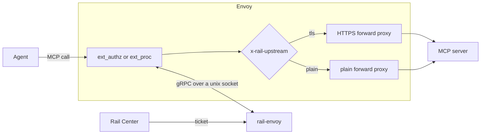

# rail-envoy

The proxy, for AI agents whose calls go out through Envoy. When an agent calls a protected MCP server, rail-envoy adds
the ticket Rail Center issued, so the server's gateway can judge the call, and sends the call on to that server. It
removes any such header the agent set itself, so an agent can't present a ticket of its own making. See the
[main README](../../README.md) for the system around it.

## Architecture

ext_authz and ext_proc over a unix socket, `RAIL_EXT_SOCKET`. For a request to a protected host, matched on its
`:authority`, it sets:

- `x-rail` with this proxy's ticket from Rail Center, or `x-rail-status` with why there is none (neither under
  `RAIL_DISABLED=true`);
- `x-rail-upstream: tls`, or `plain` for an `http://` entry, for Envoy to route on;
- `:authority` to the host and port to connect to: the entry's port, else the agent's, where `:80` counts as none.

Any other request gets none of these. From every request it removes the agent's own `x-rail`, `x-rail-status` and
`x-rail-upstream` but the one it sets, every other header whose name starts with `x-rail-`, and every header whose name
has an `_`.

- **Allows every request.** It doesn't judge calls yet: the gateway does.
- **Presents only its own ticket.** The agent's `x-rail` headers never reach an upstream through it.
- **The ticket never affects health.** Without one, it fails closed by design, and a restart wouldn't help.
- **Never logs the ticket,** only a fingerprint showing that it rotated.

## At startup

It runs as `rail-envoy proxy` (`rail proxy` in its image), its one role. The role has no default: none, or another, is a
usage error, exit 2. It logs `starting`, with its version, commit and role, then reads every setting, and prints every
refusal at once and exits 2, so they're all fixed in one round; a socket it can't listen on exits 2 too. A socket left
by an earlier run is replaced, and anything else at the path refused; the socket is made `0660`, since Envoy runs in its
group as another user. Then it logs a `setting` line for each setting it uses, with its value and whether it came from
the environment or the default, a secret only as `set` or `unset`. A value that weakens something is logged as a warning
saying what (`RAIL_DISABLED=true`, an `http://` Rail Center), and so is a `RAIL_…` variable nothing reads, as a likely
typo. It starts fetching the ticket, then logs `serving Envoy`. Every line, `starting` included, is in the format
`RAIL_LOG_FORMAT` names: text by default, or JSON.

## When Rail Center is down

The ticket held is kept while it's valid, and fetched again with a backoff. It's refreshed at half its remaining life,
or after `RAIL_TICKET_REFRESH_SECONDS`, whichever comes first, so a short one is replaced before it lapses. Without a
valid ticket, a protected host's calls carry `x-rail-status`:

- `issuer-unreachable`: no answer yet, or the last answer was a failure to reach Rail Center;
- `expired`: the ticket held lapsed with no valid one to replace it;
- `not-found`: Rail Center answered that this host and sandbox have no ticket.

## Run it beside Envoy

Envoy's configuration is the customer's, so we can only recommend it. rail-envoy needs at least:

- ext_authz or ext_proc on the request headers, over the unix socket;
- either fail closed (`failure_mode_allow: false`), or fail open with Envoy removing `x-rail`, `x-rail-*` and `_`
  headers before the route is picked and before the callout: `early_header_mutation_extensions` and
  `headers_with_underscores_action: DROP_HEADER` on the connection manager. Otherwise, while rail-envoy is down, the
  agent's own headers cross, and its `x-rail-upstream` picks the route. Failing open, while it's down a protected host's
  requests go as the agent sent them, over plain HTTP, usually at port 80, so they usually fail to connect, and no
  ticket is sent;
- every request header reported: no `allowed_headers` or `disallowed_headers` on ext_authz, no `forward_rules` on
  ext_proc. Otherwise only `x-rail`, `x-rail-status` and `x-rail-upstream` are sure to be removed;
- `allow_all_routing` (ext_authz's `decoder_header_mutation_rules`, ext_proc's `mutation_rules`), so it can rewrite
  `:authority`, and no rules that refuse its other changes, which Envoy may otherwise drop silently;
- the route picked again after the callout: `clear_route_cache: true` on ext_authz; ext_proc's answer asks for it;
- routes on `x-rail-upstream` to an HTTPS and a plain dynamic forward proxy cluster, each removing the header before the
  upstream.

[`e2e/envoy/envoy-ext-authz.yaml`](../../e2e/envoy/envoy-ext-authz.yaml) and
[`envoy-ext-proc.yaml`](../../e2e/envoy/envoy-ext-proc.yaml) are working examples; they fail open.

## Configuration

Every setting it reads, its own and those both hosts share, is in
[`CONFIGURATION.md`](../../CONFIGURATION.md#rail-envoy).

## Health

It serves `grpc.health.v1` on the same socket: SERVING while it serves, NOT_SERVING once it's stopping.
`rail-envoy probe` (`rail probe` in its image) asks it, for an exec probe, and exits 0 only on SERVING; it waits at most
5 s, so give the probe a longer timeout. It names no role, since the server answers for its own, and reads only
`RAIL_EXT_SOCKET`.

## Shutdown

On SIGTERM or Ctrl-C it reports NOT_SERVING and drains for at most 5 s, then cuts the connections still open: Envoy
keeps them, and an ext_proc stream lasts as long as its request. With Rail Center on, its thread then has at most 1 s
more to stop, so 6 s in all.

## Caveats

- **ext_proc's full-duplex body mode fails:** rail-envoy doesn't send that body back yet, so Envoy answers 500 and
  nothing reaches the upstream. Every other body mode, and ext_authz with a body, passes the body whole.
- **An `http://` protected host** gets the ticket in the clear.

## The image

Release `vX.Y.Z` is `ghcr.io/datrail/railguard-envoy:X.Y.Z`, for linux/amd64 and linux/arm64, also tagged `X.Y`, and
`latest` if it's the highest stable release; a prerelease is tagged only `X.Y.Z-…`. It carries an SBOM and a signed
provenance attestation, which `gh attestation verify oci://ghcr.io/datrail/railguard-envoy:X.Y.Z --owner datrail`
checks, and its dependencies' licences in `/THIRD-PARTY-NOTICES`. Its first log line, `starting`, gives the release tag
and the commit.

`docker build -f crates/rail-envoy/Dockerfile .` builds it, from the repository root: distroless, as uid 10001, serving
on `/run/rail/ext.sock`, in a volume to share with Envoy. The binary is `/usr/local/bin/rail`, the entrypoint, with no
default role: run the image with `proxy`, and for a health check, run `rail probe`.

## From source

`cargo build --release -p rail-envoy` builds `target/release/rail-envoy`. `make test` runs its tests, and
`make e2e-envoy` runs it behind Envoy (see [the stacks](../../e2e/README.md)).
