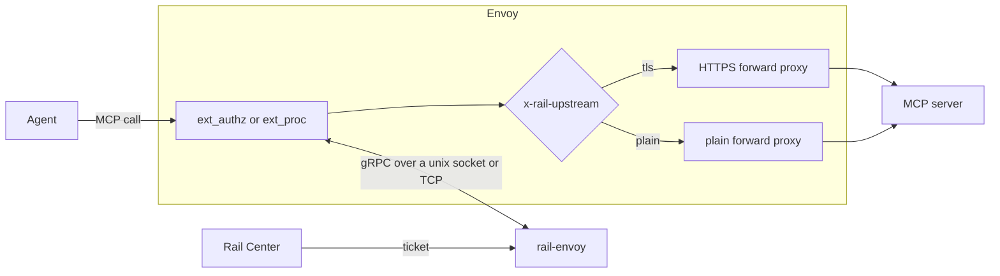
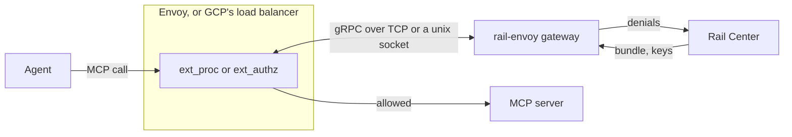

# rail-envoy

The proxy, for AI agents whose calls go out through Envoy. When an agent calls a protected MCP server, rail-envoy adds
the ticket Rail Center issued, so the server's gateway can judge the call, and sends the call on to that server. It
removes any such header the agent set itself, so an agent can't present a ticket of its own making.

It's also the gateway, for MCP servers behind Envoy, or behind GCP's Application Load Balancer, which calls it through a
Service Extension: it judges each call against the policy bundle, as rail-apigee does on Apigee (see
[As the gateway](#as-the-gateway)). See the [main README](../../README.md) for the system around it.

## Architecture

ext_authz and ext_proc over a unix socket, `RAIL_EXT_SOCKET`, or TCP, `RAIL_CALLOUT_PORT`: exactly one must be set.
Whatever reaches it can ask for the ticket, so the proxy belongs on the socket; a port must be reachable only by Envoy.
For a request to a protected host, matched on its `:authority`, it sets:

- `x-rail` with this proxy's ticket from Rail Center, or `x-rail-status` with why there is none (neither under
  `RAIL_DISABLED=true`);
- `x-rail-upstream: tls`, or `plain` for an `http://` entry, for Envoy to route on;
- `:authority` to the host and port to connect to: the entry's port, else the agent's, where `:80` counts as none.

Any other request gets none of these. From every request it removes the agent's own `x-rail`, `x-rail-status` and
`x-rail-upstream` but the one it sets, every other header whose name starts with `x-rail-`, and every header whose name
has an `_`.

- **Allows every request.** It doesn't judge calls yet: the gateway does.
- **Presents only its own ticket.** The agent's `x-rail` headers never reach an upstream through it.
- **The ticket never affects liveness,** only readiness. Without one, it fails closed by design, and a restart wouldn't
  help.
- **Never logs the ticket,** only a fingerprint showing that it rotated.

## At startup

It runs as `rail-envoy proxy` or `rail-envoy gateway` (`rail proxy`, `rail gateway` in its image), one role per process.
The role has no default: none, or another, is a usage error, exit 2. It logs `starting`, with its version, commit and
role, then reads every setting, and prints every refusal at once and exits 2, so they're all fixed in one round; a
socket it can't listen on exits 2 too. A socket left by an earlier run is replaced, and anything else at the path
refused; the socket is made `0660`, since Envoy runs in its group as another user. Then it logs a `setting` line for
each setting it uses, with its value and whether it came from the environment or the default, a secret only as `set` or
`unset`. A value that weakens something is logged as a warning saying what (`RAIL_DISABLED=true`, an `http://` Rail
Center), and so is a `RAIL_…` variable nothing reads, as a likely typo. It starts fetching the ticket, or as the gateway
the bundle and the signing keys, then logs `serving Envoy`. Every line, `starting` included, is in the format
`RAIL_LOG_FORMAT` names: JSON by default, Cloud Logging's on Cloud Run, or text.

## When Rail Center is down

The ticket held is kept while it's valid, and fetched again with a backoff. It's refreshed at half its remaining life,
or after `RAIL_TICKET_REFRESH_SECONDS`, whichever comes first, so a short one is replaced before it lapses. Without a
valid ticket, a protected host's calls carry `x-rail-status`:

- `issuer-unreachable`: no answer yet, or the last answer was a failure to reach Rail Center;
- `expired`: the ticket held lapsed with no valid one to replace it;
- `not-found`: Rail Center answered that this host and sandbox have no ticket.

## Run it beside Envoy

Envoy's configuration is the customer's, so we can only recommend it. rail-envoy needs at least:

- ext_authz or ext_proc on the request headers, over the unix socket;
- either fail closed (`failure_mode_allow: false`), or fail open with Envoy removing `x-rail`, `x-rail-*` and `_`
  headers before the route is picked and before the callout: `early_header_mutation_extensions` and
  `headers_with_underscores_action: DROP_HEADER` on the connection manager. Otherwise, while rail-envoy is down, the
  agent's own headers cross, and its `x-rail-upstream` picks the route. Failing open, while it's down a protected host's
  requests go as the agent sent them, over plain HTTP, usually at port 80, so they usually fail to connect, and no
  ticket is sent;
- every request header reported: no `allowed_headers` or `disallowed_headers` on ext_authz, no `forward_rules` on
  ext_proc. Otherwise only `x-rail`, `x-rail-status` and `x-rail-upstream` are sure to be removed;
- `allow_all_routing` (ext_authz's `decoder_header_mutation_rules`, ext_proc's `mutation_rules`), so it can rewrite
  `:authority`, and no rules that refuse its other changes, which Envoy may otherwise drop silently;
- the route picked again after the callout: `clear_route_cache: true` on ext_authz; ext_proc's answer asks for it;
- routes on `x-rail-upstream` to an HTTPS and a plain dynamic forward proxy cluster, each removing the header before the
  upstream.

[`e2e/envoy-proxy/envoy-ext-authz.yaml`](../../e2e/envoy-proxy/envoy-ext-authz.yaml) and
[`envoy-ext-proc.yaml`](../../e2e/envoy-proxy/envoy-ext-proc.yaml) are working examples; they fail open.

## As the gateway

`rail gateway` judges each call whole, its headers and its body, through the same gateway as rail-apigee: the same
waits, deadline, posture, fallbacks, denial reports and answers. A call allowed goes on without the agent's `x-rail`,
`x-rail-*` and `_` headers; one refused gets 403 `{"error": "denied by policy"}`, or 503
`{"error": "policy ruleset cannot be applied"}`, or, past `RAIL_MAX_BODY_MB`, 413 `{"error": "request body too large"}`.

- **ext_proc** must send the request's headers, and its body `FULL_DUPLEX_STREAMED` or `BUFFERED`:
  - **full duplex** (GCP's load balancer): every answer is held until the body ends, by its last chunk or the trailers
    (`request_trailer_mode: SEND`); then the headers are answered, the body sent back in chunks of at most 64 KiB, and
    the trailers. A streamed body is refused as soon as it's past the cap;
  - **buffered:** the headers are answered at once, and the one body message judged; Envoy holds the body up to the
    listener's `per_connection_buffer_limit_bytes` (1 MiB by default), and answers 413 itself past it. Set
    `request_trailer_mode: SEND` too, or a request with trailers and no body goes on unjudged;
  - **any other body mode** (`STREAMED`, Envoy's and the load balancer's default, `BUFFERED_PARTIAL`, `NONE`), or a
    stream that doesn't say its mode, is refused with 503 and an error line naming it, since the whole body can't be
    seen first. So is a stream in `observability_mode`, whose answers Envoy ignores.
- **ext_authz** must send the body: `with_request_body`, with `allow_partial_message: false`. A body cut short is
  refused 413, and a `POST` with none, unless its size is known to be 0, 503: never judged as if whole.
- **Fail closed:** `failure_mode_allow: false`, on either filter, so a call the gateway didn't answer never reaches the
  server. A stream that fails before its call is answered, such as with a buffered body past
  `RAIL_CALLOUT_GRPC_MAX_MESSAGE_MB`, ends in an error, never as if answered.
- **Time:** Envoy's `message_timeout` (ext_proc) or `timeout` (ext_authz), both 200 ms by default, must be at least 6 s:
  a call can wait 2 s for a bundle and 2 s for a key, within the gateway's 5 s.
- **Every request header reported:** no `forward_rules` or `allowed_headers`, or a rule reading a header can't see it.

[`e2e/envoy-gateway/envoy.yaml`](../../e2e/envoy-gateway/envoy.yaml) is a working example of each.

### Behind GCP's load balancer

On Cloud Run, as a serverless NEG behind an HTTP/2 backend service, called by an `LbTrafficExtension`:

- `args = ["gateway"]`, `RAIL_CALLOUT_PORT` set to the container port, and HTTP/2 end to end, since it speaks gRPC over
  plaintext HTTP/2; its startup probe on `rail.Ready`;
- the extension's events `REQUEST_HEADERS`, `REQUEST_BODY` and `REQUEST_TRAILERS`,
  `request_body_send_mode: FULL_DUPLEX_STREAMED`, `failOpen: false`, and its `timeout` at least 6 s;
- the service's ingress internal and load balancing only: a Service Extension needs it to allow unauthenticated calls,
  so anything else that reaches it could drive judgements and denial reports.

## Configuration

Every setting it reads, its own and those both hosts share, is in
[`CONFIGURATION.md`](../../CONFIGURATION.md#rail-envoy).

## Health

It serves `grpc.health.v1` on the same listener: `""`, ext_authz's and ext_proc's service names are liveness, SERVING
while it serves; `rail.Ready` is readiness, SERVING while the proxy holds a valid ticket, or the gateway a bundle, or
with Rail Center disabled. All are NOT_SERVING once it's stopping. A readiness answer gives the role's state in its
metadata, `rail-ready-proxy`: `valid`, `expired`, `not-found` or `issuer-unreachable` (`x-rail-status`'s words); or
`rail-ready-gateway`: `held` or `none`; either `disabled`, or `stopping`.

`rail-envoy probe [--ready]` (`rail probe [--ready]` in its image) asks it, for an exec probe, and exits 0 only on
SERVING; it waits at most 5 s, so give the probe a longer timeout. It names no role, since the server answers for its
own, and reads only `RAIL_EXT_SOCKET` and `RAIL_CALLOUT_PORT`, asking `127.0.0.1` for a port. With `--ready` it prints
the state after the status, e.g. `not serving: NOT_SERVING (proxy: expired)`. Use readiness to hold traffic back until a
ticket is held, never to restart it: a ticket that lapses turns it not ready, and a restart wouldn't bring one.

## Shutdown

On SIGTERM or Ctrl-C it reports NOT_SERVING and drains for at most 5 s, then cuts the connections still open: Envoy
keeps them, and an ext_proc stream lasts as long as its request. With Rail Center on, its thread then has at most 1 s
more to stop, so 6 s in all.

## Caveats

- **The proxy and ext_proc's full-duplex body mode:** the proxy doesn't send that body back yet, so Envoy answers 500
  and nothing reaches the upstream. Every other body mode, and ext_authz with a body, passes the body whole. The gateway
  supports full duplex.
- **The gateway's memory:** it holds each call's body until it's judged, which can take up to about twice
  `RAIL_MAX_BODY_MB` per call in flight. Size its memory for the calls it serves at once.
- **An encoded body isn't decoded:** a `Content-Encoding: gzip` call reads as naming no endpoint, so under
  `binding_fallback: pass` it escapes every rule on `request.endpoint_key`. Apigee decompresses before its callout;
  Envoy and GCP's load balancer don't.
- **GCP's load balancer, failing open:** its docs say a full-duplex extension fails open on errors before the first body
  chunk. With a gateway it can't reach, it fails closed, answering 500
  ([the live harness](../../e2e/envoy-gateway/live/README.md)), and a body held back past the extension's timeout is
  waited for and judged; a gateway failing its stream after accepting it is untested.
- **An `http://` protected host** gets the ticket in the clear.

## The image

Release `vX.Y.Z` is `ghcr.io/datrail/railguard-envoy:X.Y.Z`, for linux/amd64 and linux/arm64, also tagged `X.Y`, and
`latest` if it's the highest stable release; a prerelease is tagged only `X.Y.Z-…`. It carries an SBOM and a signed
provenance attestation, which `gh attestation verify oci://ghcr.io/datrail/railguard-envoy:X.Y.Z --owner datrail`
checks, and its dependencies' licences in `/THIRD-PARTY-NOTICES`. Its first log line, `starting`, gives the release tag
and the commit.

`docker build -f crates/rail-envoy/Dockerfile .` builds it, from the repository root: distroless, as uid 10001, with
`/run/rail` a volume to share the socket with Envoy (set `RAIL_EXT_SOCKET=/run/rail/ext.sock`). The binary is
`/usr/local/bin/rail`, the entrypoint, with no default role: run the image with `proxy` or `gateway`, and for a health
check, run `rail probe`.

## From source

`cargo build --release -p rail-envoy` builds `target/release/rail-envoy`. `make test` runs its tests, and
`make e2e-envoy-proxy` and `make e2e-envoy-gateway` run it behind Envoy (see [the stacks](../../e2e/README.md)).
