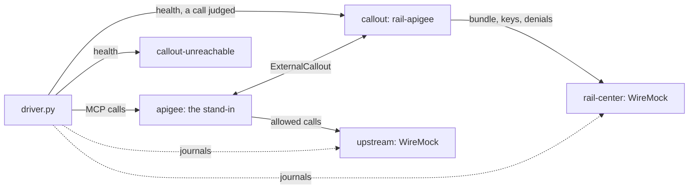

# The apigee stack

Checks rail-apigee as Apigee would use it, without paying for Apigee: first rail-apigee on its own (health, readiness, a
call judged), then behind a stand-in that does what an Apigee proxy running `apiproxy/` does with its answers. The cases
include what runs on real Apigee found it doing, such as splitting a header on its commas, so the stand-in is held to
it. [`live/`](live/README.md) runs the same driver against real Apigee, to check the stand-in is right. See
[the stacks](../README.md) for what they share.

## Architecture

`compose.yml` holds:

- `rail-center`, a WireMock stub serving the bundle (to the service token only), the signing keys, and taking denials
  (`rail-center-mappings`);
- `upstream`, a WireMock MCP server (`upstream-mappings`);
- `callout`, rail-apigee enrolled with the stub; and `callout-unreachable`, on port 9100 with a Rail Center it can't
  reach, which must still start;
- `apigee`, the stand-in, with two proxies: `/mcp`, judged by `callout`, and `/no-callout`, whose callout never
  resolves;
- `driver.py`, which asserts what reached each stub, from their request journals.

## The tree

- `apiproxy/` is the Apigee proxy rail-apigee's README describes
  ([Run it beside Apigee](../../crates/rail-apigee/README.md#run-it-beside-apigee)), with its placeholders.
  `RF-E2E-OperatorFault.xml` is a test-only policy, faulting before the callout, to check an operator's own fault keeps
  its error.
- `apigee_standin.py`, each of its rules naming its source, and `driver.py` run on Python with gRPC
  (`python.Dockerfile`): the ExternalCallout stubs generated from the vendored `.proto`, the packages pinned by hash
  (`requirements.txt`).
- `rail-center-mappings/` and `upstream-mappings/` are the stubs' answers.

## Running it

`make e2e-apigee`, or `make e2e-apigee-images` first to build and pull ahead; `make e2e-down STACK=apigee` removes
what's left.

## What it proves that the unit suite cannot

- **The image as shipped:** built from this checkout, answering its health checks on the port configured, and starting
  with a Rail Center it can't reach.
- **Its answers as Apigee applies them:** the `x-rail` and `_` headers it removes are gone at `upstream`, `RF-Refuse`
  answers its status and body, and the rest of the call arrives as sent.
- **The proxy bundle,** `apiproxy/`, does what rail-apigee needs: a callout that never resolves answers 503, and nothing
  reaches `upstream`; an operator's own fault keeps its error.
- **Apigee's ways, as seen live:** a header split on its commas, the query kept out of the endpoint key, the 4 MiB
  answer, and the 413 past 10 MB.
- **Rail Center as it's called:** the bundle fetched with the service token, and each refusal's denial reported as Rail
  Center reads it.

## Easy to get wrong

- **The stand-in is a model of Apigee,** not Apigee: a case of Apigee's behaviour is run live first, then here (see
  [`live/`](live/README.md)).
- **A denial is reported after the caller is answered,** so the driver waits for each one; asserting at once would race
  it.
- **`upstream` is stateful:** every call after `initialize` carries its session id. Session messages are forwarded
  unjudged, so a refusal must stop the `tools/call` itself.
- **A refusal naming no policy omits `policy_id`:** the driver matches its absence, not a `null`.
- **A request no stub matched fails the run,** which no count of matched requests would show; each reset sweeps for them
  first, so the last sweep covers the whole run.

## Not covered here

- **Real Apigee:** [`live/`](live/README.md), by hand.
- **Signed tickets:** no case sends one.
- **The drain and SIGTERM:** `rail-envoy`'s tests run them, for both hosts (`rail-grpc-host`).
- **Load:** no case measures throughput or the concurrency limit.
