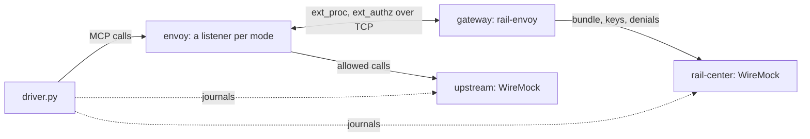

# The envoy-gateway stack

Checks rail-envoy's gateway as GCP's Application Load Balancer, or a customer's Envoy, would call it: a real Envoy in
the load balancer's place, with one listener per way of calling it (ext_proc full duplex, as the load balancer does;
ext_proc buffered; ext_authz with the body), each in front of an MCP server. The gateway's cases every host passes alike
run through each, then what only Envoy shows. See [the stacks](../README.md) for what they share.

## Architecture

`compose.yml` holds:

- `rail-center` and `upstream`, the stubs the apigee stack uses too (`../gateway/`);
- `gateway`, rail-envoy as `rail gateway` on port 8080, as on Cloud Run, with `RAIL_MAX_BODY_MB=4`;
- `envoy`, with `envoy.yaml`'s listeners: 10000 ext_proc `FULL_DUPLEX_STREAMED`, 10001 ext_proc `BUFFERED`, 10002
  ext_authz with the body, 10003 ext_proc `STREAMED` (refused), and 10004 a gateway nothing can reach;
- `driver.py`, which runs [`../gateway/gateway_cases.py`](../gateway/README.md) through the first three, then this
  stack's own cases.

## Running it

`make e2e-envoy-gateway`, or `make e2e-envoy-gateway-images` first to build and pull ahead;
`make e2e-down STACK=envoy-gateway` removes what's left.

## What it proves that the unit suite cannot

- **Envoy takes the gateway's answers as meant,** in each mode: the headers it removes are gone at `upstream`, its
  refusals reach the agent as sent, and a 3 MiB body sent back in full duplex arrives byte for byte.
- **The cap through Envoy:** a 5 MiB call is refused 413 by the gateway in every mode, and nothing reaches `upstream`.
- **The modes it refuses:** Envoy's default, `STREAMED`, is answered 503.
- **Failing closed:** with `failure_mode_allow: false`, a gateway nothing can reach lets nothing through.

## Easy to get wrong

- **Envoy's own limits come first:** a buffered body, or one for ext_authz, is held up to the listener's
  `per_connection_buffer_limit_bytes` (1 MiB by default), and Envoy answers 413 itself past it; the listeners raise it,
  so the gateway's cap is what's tested.
- **The timeouts:** Envoy's 200 ms defaults (`message_timeout`, ext_authz's `timeout`) would fail any call waiting for a
  bundle; the listeners use 6 s, above the gateway's 5 s deadline.

## Not covered here

- **GCP's load balancer itself:** [the live harness](live/README.md), paid and run by hand.
- **Signed tickets:** no case sends one.
- **An encoded body:** not decoded; no case sends one.
