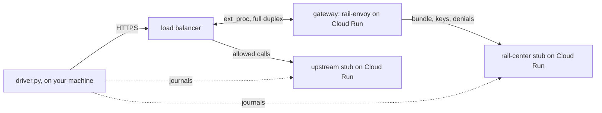

# The live harness

Runs the [envoy-gateway stack](../README.md)'s checks through GCP's global external Application Load Balancer, which
calls rail-envoy's gateway on Cloud Run through a traffic extension, in full duplex. The stack runs a real Envoy in the
load balancer's place; only the load balancer can show it calls the gateway the same way, and answer what its docs don't
say. A session costs money while it's up, so it's run by hand, never in CI.

**A test harness, not a deployment template.** It takes shortcuts a production setup shouldn't: open stubs, a
self-signed certificate, fake credentials. For running the gateway, see
[rail-envoy's README](../../../crates/rail-envoy/README.md#behind-gcps-load-balancer).

One Terraform root, this folder: the load balancer in front of the `upstream` stub, the traffic extension, the image
registry, the service accounts, and on Cloud Run the gateway and the `rail-center` and `upstream` stubs. All of it lasts
one session, `session.sh up` to `session.sh down`.

## Architecture



The traffic extension has three chains, tried in order, the first whose condition matches running:

| Chain        | Matches                          | Calls                                               | Body mode                 |
| ------------ | -------------------------------- | --------------------------------------------------- | ------------------------- |
| `streamed`   | header `x-e2e-chain: streamed`   | the gateway                                         | `STREAMED`, GCP's default |
| `no-gateway` | header `x-e2e-chain: no-gateway` | a serverless NEG naming a service that never exists | `FULL_DUPLEX_STREAMED`    |
| `judged`     | any other call to `/mcp`         | the gateway                                         | `FULL_DUPLEX_STREAMED`    |

Each has `REQUEST_HEADERS`, `REQUEST_BODY` and `REQUEST_TRAILERS`, `failOpen: false`, and a timeout of `timeout_ms`
(6000 by default, past the gateway's 5 s deadline). A header picks the chain, not a path, so every call reaches the
upstream's `/mcp` unchanged. Only `/mcp` reaches the gateway and the upstream; any other path is redirected to it.
Scanners find the public IP within minutes, and their calls must show in neither the upstream's journal nor the denials.

**The extension is imported with `gcloud`, not made by the google provider:** the provider (8.11.0, the latest) can't
set `requestBodySendMode`, lists no `REQUEST_TRAILERS`, and says the timeout is at most 1000 ms, where the API takes 10
to 10000. `extension.tf` builds it from the API's own fields, and a `terraform_data` resource imports it on apply and
deletes it on destroy, so Terraform still orders it after the forwarding rule and the backends, and before them on
destroy.

## A session

Needs `gcloud`, `terraform`, `docker` and `curl`. Owner on the project is enough; a narrower set of roles is untested.

```sh
cd e2e/envoy-gateway/live
cp terraform.tfvars.example terraform.tfvars   # your values
./session.sh up     # builds and pushes the images, applies, waits for the load balancer
./session.sh test   # runs the driver against the session, then prints the gateway's warnings
./session.sh down   # destroys everything, then checks no traffic extension is left
```

- **Cost:** the load balancer's forwarding rule and three always-on Cloud Run instances, billed from `up` until `down`,
  so **always end with `down`**.
- **`up` waits** until a `GET` through the load balancer gets the upstream stub's 405 six times in a row, 5 s apart, for
  up to 10 minutes: that answer means the extension called the gateway and the gateway let the call through. It then
  checks the stubs' `/__admin` refuses a call without the password. If the wait times out, it prints the last answer.
- **`up` again** on a running session rebuilds the images, whose digests change on every build, so it redeploys the
  three services, and the extension if it changed: about 3 minutes.

## What the driver checks

`./session.sh test` runs `../driver.py` in the stack's Python image, with `E2E_TARGET=live`, the session's URLs, its
certificate and the stubs' password, all as `E2E_*` variables; its exit code is the result:

- the gateway's cases every host passes alike ([`../../gateway/`](../../gateway/README.md)), through the `judged` chain;
- a 3 MiB call reaches `upstream` byte for byte, sent back by the gateway a chunk at a time;
- a 5 MiB call is refused 413 by the gateway (`RAIL_MAX_BODY_MB=4`), and nothing reaches `upstream`;
- a call through `streamed` is answered 503, and nothing reaches `upstream`;
- a call through `no-gateway` is answered with a 5xx, and nothing reaches `upstream`;
- a call without a ticket whose body comes 8 s after its headers, past `timeout_ms`, is refused, 403 or a 5xx, and
  nothing reaches `upstream`: an error before the first body chunk, which Google's docs say fails open.

After the driver, `session.sh` prints the gateway's lines at WARNING or above from the run: the `streamed` refusal names
the mode the load balancer said it sends, or `unknown` if it sent no `protocol_config`.

## What sessions showed

What the gateway's design left to check on GCP (first session, 2026-11-12):

- **The load balancer fails closed with a gateway it can't reach:** a call through `no-gateway` is answered 500, and
  nothing reaches `upstream`, in spite of Google's docs on errors before the first body chunk. Only an unreachable
  backend is tried; a gateway failing its stream after accepting it isn't.
- **It sends `protocol_config`:** the `streamed` refusal's log line names `STREAMED`, and full duplex is read from it,
  so no setting naming the mode is needed.
- **The extension takes a 6 s timeout,** as the API says (10 to 10000 ms), not the provider's docs (1000).
- **Cloud Run serves as an extension's backend:** a serverless NEG behind an `HTTP2` backend service, its ingress
  internal and load balancing.
- **A 3 MiB body in full duplex** reaches `upstream` byte for byte, so the load balancer holds at least that while the
  gateway judges; a larger one needs `RAIL_MAX_BODY_MB` raised in `services.tf`.
- **Cloud Logging takes the gateway's `time` as the entry's timestamp,** and its `severity` as the entry's.

## Auth and TLS

| Hop                                | Auth                                                                         |
| ---------------------------------- | ---------------------------------------------------------------------------- |
| agent (the driver) → load balancer | none; HTTPS with a self-signed certificate                                   |
| load balancer → gateway            | none: Cloud Run's IAM check is off, its ingress internal and load balancing  |
| gateway → `rail-center`            | `Bearer rc_svc_e2e…`, which picks the stub's bundle; IAM check off           |
| load balancer → `upstream`         | the agent's `Authorization`, forwarded as sent; IAM check off                |
| driver → each stub's `/__admin`    | basic auth, user `e2e`, password `terraform output -raw stub_admin_password` |

- **The gateway has Cloud Run's IAM check off,** since a Service Extension calls it with no credential. Its ingress is
  internal and load balancing only, so nothing else reaches it, as in production.
- **The stubs have the IAM check off** and open ingress, for the same reasons as on the Apigee harness: the gateway's
  Rail Center credential and the agent's are in `Authorization`, and the driver reads their journals.
- **The project's org policies** (`iam.allowedPolicyMemberDomains`, `run.managed.requireInvokerIam`) must allow
  `invoker_iam_disabled`; the services fail to deploy otherwise.
- **The gateway's probes** call its gRPC health service, on `rail.Ready` until it holds a bundle, then on liveness.
- **The gateway logs at `debug`** (`gcloud run services logs read <prefix>-gateway`).
- **Exposed during a session:** the load balancer and the stubs, open to anyone. They serve fake bundles and fake MCP
  answers, and no real credential is used. Nothing is left once `down` has run.

## Easy to get wrong

- **Both `gcloud` logins must be current:** `gcloud auth login`, for `session.sh` and the extension's import, and
  `gcloud auth application-default login`, for Terraform.
- **The session's state is local:** `terraform.tfstate` and `terraform.tfvars` are what `down` destroys from, so they're
  kept until it has run.
- **An extension left behind holds the forwarding rule,** so nothing behind it can be deleted. `down` deletes the
  session's extensions with `gcloud` before `terraform destroy`, since Terraform skips a failed import's destroy step,
  and lists any left after.

## Not covered here

- **ext_proc buffered and ext_authz:** the load balancer's traffic extension calls in full duplex or streamed only; the
  stack covers the others.
- **Signed tickets:** no case sends one.
- **A production setup:** see [rail-envoy's README](../../../crates/rail-envoy/README.md#behind-gcps-load-balancer).
