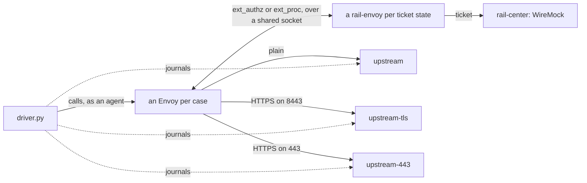

# The envoy-proxy stack

Checks that rail-envoy, behind a real Envoy, attaches tickets as it should: for each state a ticket can be in (held, not
found, expired, Rail Center down, disabled), and for each kind of protected host, the right headers reach the right
upstream, and nothing reaches the wrong one. It also checks the configurations rail-envoy's README recommends, and that
Envoy fails open as described when rail-envoy is down. See [the stacks](../README.md) for what they share.

## Architecture

`compose.yml` holds:

- `rail-center`, a WireMock stub answering by sandbox name (`rail-center/mappings`);
- one rail-envoy per ticket state (`ext`, `ext-not-found`, `ext-expired`, `ext-issuer-down`, `ext-disabled`), each with
  an Envoy in front on `envoy-ext-authz.yaml`; and `envoy-ext-proc`, on `envoy-ext-proc.yaml`;
- `envoy-no-ext-authz` and `envoy-no-ext-proc`, whose socket nothing serves on, so every callout fails and Envoy fails
  open;
- `envoy-variants`, on `envoy-variants.yaml` (below);
- the upstreams, WireMock: plain HTTP, HTTPS on 8443, and HTTPS on 443 (`upstream-mappings`);
- `driver.py`, which sends requests through each Envoy and asserts what reached each upstream.

## The tree

- `envoy-ext-authz.yaml` and `envoy-ext-proc.yaml` are the working examples rail-envoy's README points to
  ([Run it beside Envoy](../../crates/rail-envoy/README.md#run-it-beside-envoy)).
- `envoy-variants.yaml` is one Envoy with a listener per config the examples don't show: both callouts in one chain,
  ext_authz's `encode_raw_headers` and body, and each ext_proc body mode, each failing closed.
- `certs.sh` makes the TLS upstreams a test CA and key at each start, for that run only.
- `rail-center/` and `upstream-mappings/` are the stubs' answers.

## Running it

`make e2e-envoy-proxy`, or `make e2e-envoy-proxy-images` first to build and pull ahead; `make e2e-down` removes what's
left.

## What it proves that the unit suite cannot

- **Envoy applies rail-envoy's changes:** the agent's `x-rail` and `_` headers never reach an upstream, the ticket or
  its status does, and `:authority` is rewritten.
- **The route is picked again** on `x-rail-upstream` after the callout, to the right upstream, over TLS or plain, at the
  right port.
- **The recommended configurations work,** over ext_authz and over ext_proc, and **fail open as described** when
  rail-envoy is down.
- **Each ticket state** gives the header it should, from a Rail Center stub answering as Rail Center does.
- **A body crosses whole,** in each body mode, with the agent's trailers or past ext_authz's `max_request_bytes`, and
  the agent gets the upstream's answer.

## Easy to get wrong

- **The first ticket fetch is in flight** as the stack comes up, so the driver waits for each extension's.
- **The full-duplex body mode is expected to fail** (`xfail`), and only as known, a 500 with nothing received:
  rail-envoy doesn't send that body back yet. A pass fails the run, so the case is updated when it's fixed.
- **Envoy may drop a change silently** when a rule refuses it, so the driver asserts on what reached the upstream, never
  on what rail-envoy answered.

## Not covered here

- **Judging:** the proxy role judges nothing; [`envoy-gateway`](../envoy-gateway/README.md) covers the gateway.
- **Signed tickets:** no case sends one.
- **The drain and SIGTERM:** `rail-envoy`'s own tests (`tests/shutdown.rs`).
